# NETWORKWALKS-B082-WK3-PM1-PM2-PASSWORD-CRACKING-
Week 3 project: cracking a locked PDF's password using John the Ripper/Johnny and Networkwalks' browser-based Hash Calculator and Password Cracker. Educational use on instructor-provided lab files.
## 1. Liability Disclaimer

These activities were performed only on the instructor-provided lab files, for education and research purposes as part of the Networkwalks Cybersecurity internship. This knowledge is not to be used to access files or systems without authorization.

---

## 2. Introduction

Password cracking is used to test how strong a password is by recovering it from a stored hash. This project covers two approaches to cracking the password of a locked PDF:

- **W3-PM1** uses **John the Ripper (JTR)** and its GUI, **Johnny**, on Windows.
- **W3-PM2** uses two free browser-based tools built by Networkwalks: the **Hash Calculator** and the **Password Cracker**.

Both approaches follow the same underlying idea: extract the password hash from the locked PDF, then try candidate passwords against that hash until one matches.

---

## 3. Tools Used

| Tool | Purpose |
|---|---|
| John the Ripper (JTR) | Password cracking engine |
| Johnny | GUI front-end for John the Ripper |
| onlinehashcrack.com PDF Hash Extractor | Extracts a crackable `$pdf$...` hash from an encrypted PDF |
| Networkwalks Hash Calculator | Browser-based tool to extract a `$pdf$...` hash from a locked PDF |
| Networkwalks Password Cracker | Browser-based dictionary attack against a pasted PDF hash |

---

## 4. Activities Performed

### 4.1 W3-PM1: Password Cracking with JTR

**Step 1 — Download John the Ripper and Johnny**

JTR and Johnny were downloaded from their official pages.

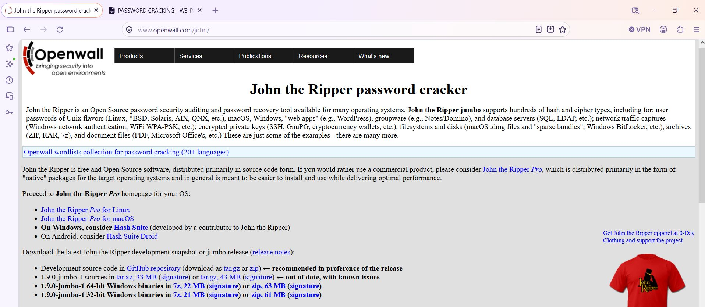
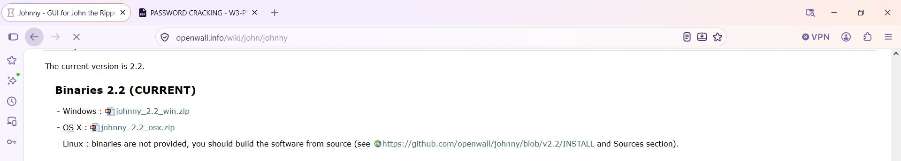

**Step 2 — Point Johnny to the John the Ripper executable**

Johnny needs the path to `john.exe` before it can run an attack.

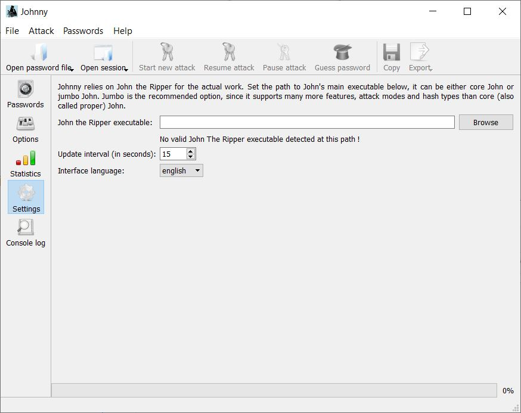

**Step 3 — Extract the PDF hash**

The locked PDF was uploaded to the Online Hash Crack PDF Hash Extractor, which converts it to a `$pdf$...` hash in the `pdf2john`/`pdf2hashcat` format.

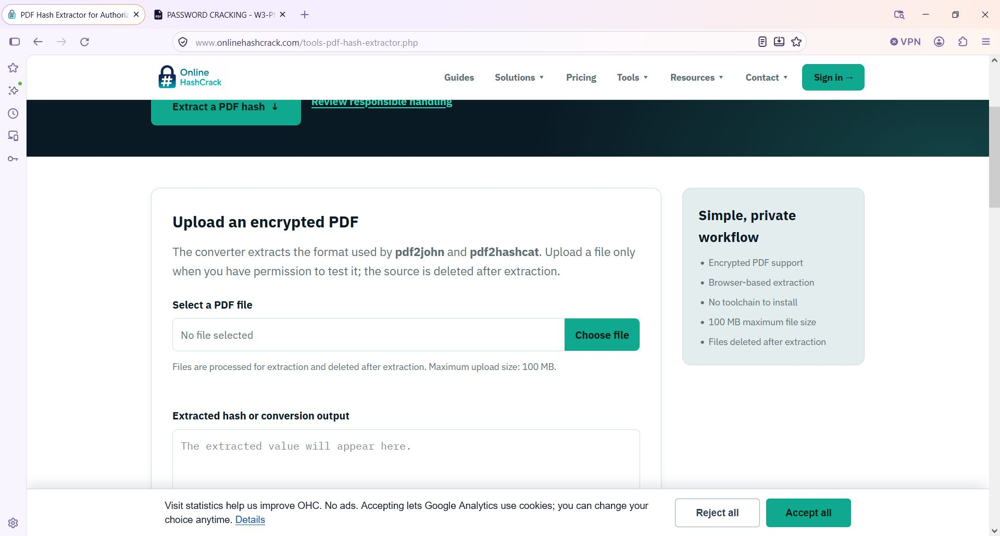
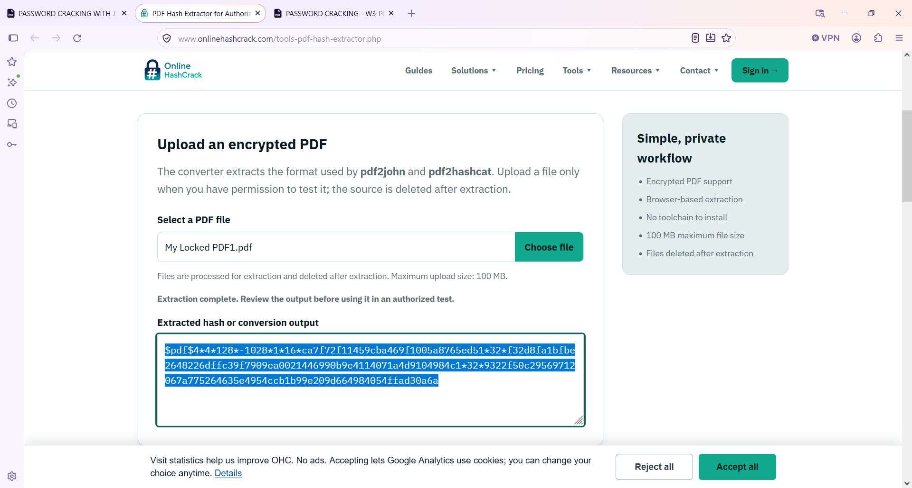

**Step 4 — Save the hash to a text file**

The extracted hash was saved as `hash1.txt`.

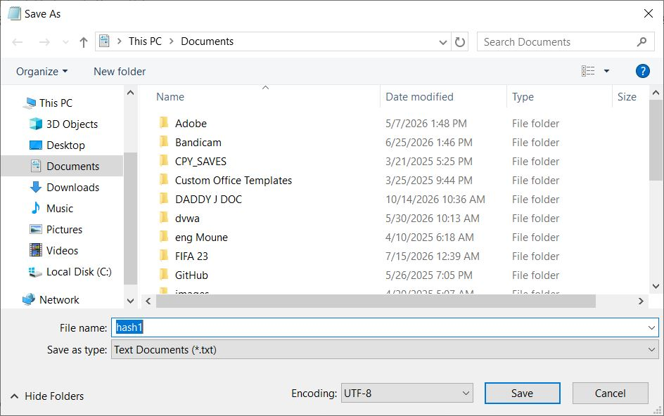
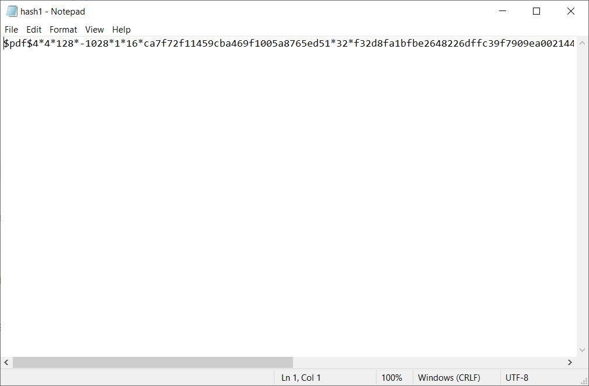

**Step 5 — Run the attack in Johnny**

The hash file was opened in Johnny and a new attack was started.

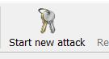

**Step 6 — Password cracked**

Johnny recovered the password for the PM1 PDF:

```
Password: good-luck
```

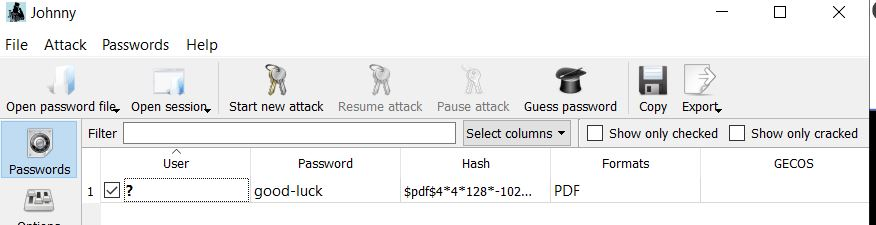

**Step 7 — Open the PDF**

Entering the cracked password unlocked the PDF, which revealed a confirmation flag.

```
Flag: nw{cybersecurity_flag_captured_2608}
```

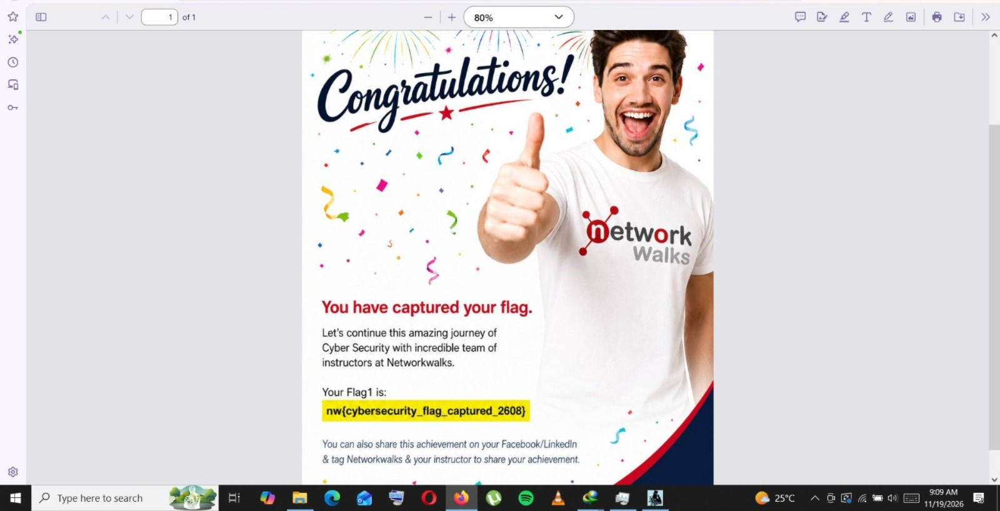

---

### 4.2 W3-PM2: Password Cracking with Networkwalks Tools

**Step 1 — Extract the hash with the Networkwalks Hash Calculator**

The PM2 PDF (`My Locked PDF1 (for NW Tools Lab WK3-PM2).pdf`) was uploaded to the Networkwalks Hash Calculator, which parses the file locally in the browser and extracts a crackable hash.

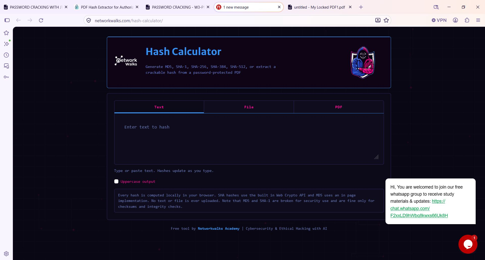
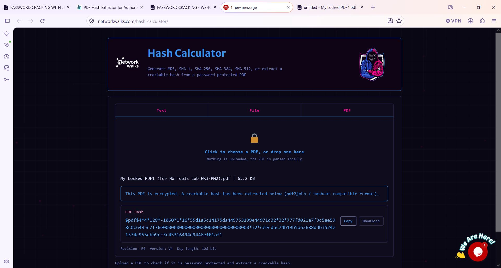

**Step 2 — Paste the hash into the Password Cracker**

The extracted `$pdf$...` hash was pasted into the Networkwalks Password Cracker, which runs a dictionary attack using a built-in wordlist (100 passwords).

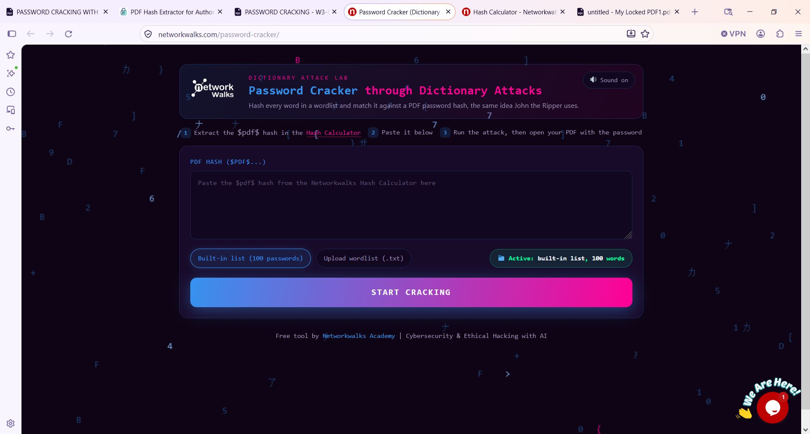
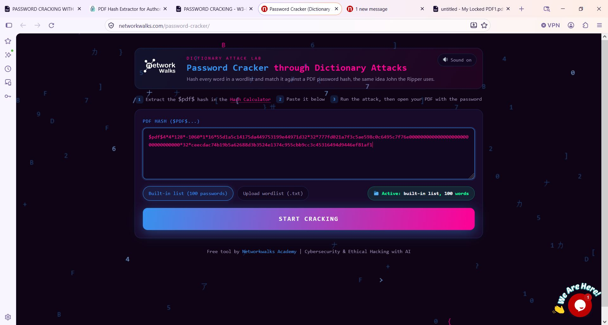

**Step 3 — Password cracked**

The tool tried candidate passwords until it found a match:

```
Password: password1
```

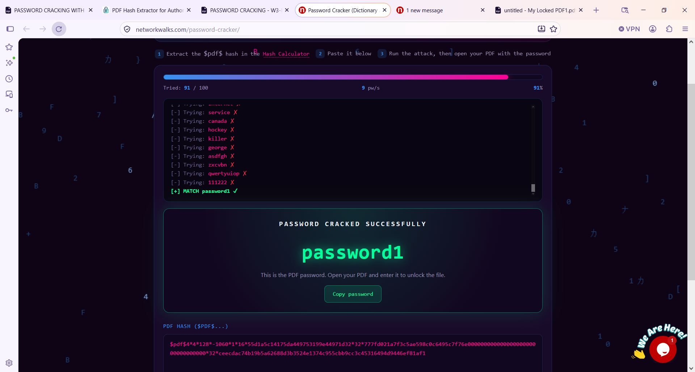

The PDF was then opened successfully using this password.

---

## 5. Troubleshooting

**Problem:** My Kali Linux VM kept crashing during this week's project, so I could not run `pdf2john` and `john` directly from the Kali terminal as originally planned.

**Solution:** I completed both modules on Windows instead — JTR + Johnny for PM1, and the browser-based Networkwalks tools for PM2, which work on any OS since they run in the browser. I informed my supervisor about the VM issue.

---

## 6. Risk Analysis / Key Takeaways

| # | Observation | Why it matters |
|---|---|---|
| 1 | Both PDFs used short, common passwords (`good-luck`, `password1`) | Common or short passwords are cracked in seconds to minutes against even a small, 100-word dictionary |
| 2 | The PDF hash could be extracted entirely client-side (browser) and offline (JTR) | No special server access is needed to attempt password recovery once a password-protected file is obtained |
| 3 | A dictionary attack (not brute-force) was enough here | Attackers often try common/known passwords first because it is far faster than exhaustive brute-force |

**Recommendation:** Use long, random, unique passwords for sensitive documents, ideally generated by a password manager, instead of common words or simple patterns.

---

## 7. Conclusion

This project showed two different ways to recover a password from a protected PDF: a dedicated offline tool (John the Ripper / Johnny) and lightweight browser-based tools (Networkwalks Hash Calculator and Password Cracker). Both approaches rely on the same idea — extract the hash, then test candidate passwords against it — and both successfully recovered short, common passwords quickly. The exercise reinforced why weak or common passwords are a serious security risk, and why this kind of testing should only be performed on files you are authorized to test.

---

## Evidence

All screenshots are in [`screenshots/`](screenshots/).

---

**Author:** Rose Mary Lecha Ngwa Mbenoh, Cybersecurity Professional B082
**Program:** Cybersecurity program at Networkwalks | Week 03 | Repository: GitHub
